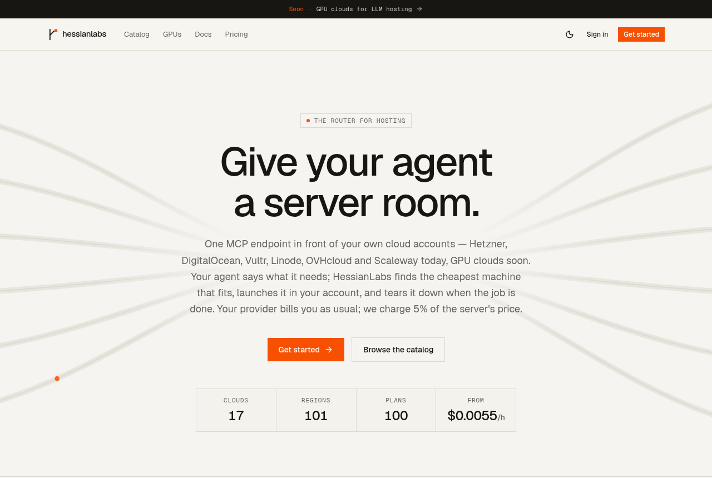
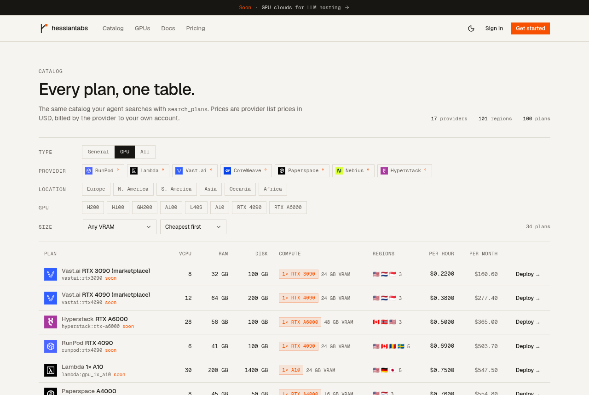
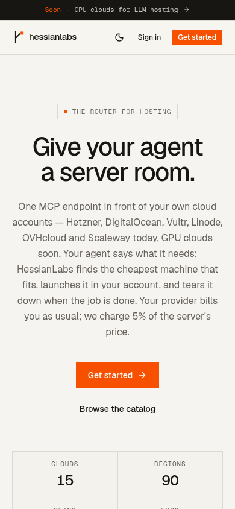

# HessianLabs website

The public site for HessianLabs, the router for hosting: the landing page, the
plan catalog and the docs. The product itself (API, MCP endpoint and dashboard)
lives in [hessianlabs-ai/project-z](https://github.com/hessianlabs-ai/project-z).



| GPU catalog | Mobile |
| --- | --- |
|  |  |

## Pages

| Path | What it is |
| --- | --- |
| `/` | Landing page: hero with live catalog stats, animated product showcase, LLM sizer, live price board, pricing and FAQ |
| `/catalog` | Every plan in one filterable table; "Deploy" opens the dashboard's New server page with the plan picked |
| `/docs` | MCP quickstart, the tools, and the REST API |

Prices, plans and the fee come live from the API's public REST endpoints (no
key needed): `GET /v1/meta`, `GET /v1/providers`, `POST /v1/plans/search`,
`GET /v1/llm/models` and `POST /v1/llm/size`. Their response types are written
out in `src/lib/api.ts`; update them when the API's catalog changes. Pages
render on the server for SEO, then the sizer and filters fetch from the
browser.

Sign in, Get started and Deploy are plain links to the dashboard. The site has
no session of its own; the dashboard sends people who are already signed in
straight on.

## Run it locally

Requirements: Bun ≥ 1.4, and the API from project-z running on :3000 (its
dashboard on :3001).

```bash
bun install
cp .env.example .env
bun run dev           # http://localhost:3002
```

| Variable | What it is |
| --- | --- |
| `VITE_API_URL` | The HessianLabs API, e.g. `https://api.hessianlabs.com` |
| `VITE_APP_URL` | The dashboard, e.g. `https://app.hessianlabs.com` |

Both are fixed at build time. Development falls back to localhost; a
production build fails without them. Point the dashboard's
`VITE_SITE_URL` (in project-z) at this site so its Docs links land here.

## Build

```bash
bun run build         # dist/client and dist/server
bun run serve         # serve the build locally
bun run check-types
bun run check         # Biome lint and format
```

## Stack

TanStack Start (React 19, SSR) with TanStack Query, Tailwind v4, and a few
shadcn/ui components on Base UI in `src/components/ui`. Animations use
`motion`. The design tokens in `src/index.css` are a copy of project-z's
`packages/ui/src/styles/globals.css`, so the site and the dashboard look the
same; change both together.
